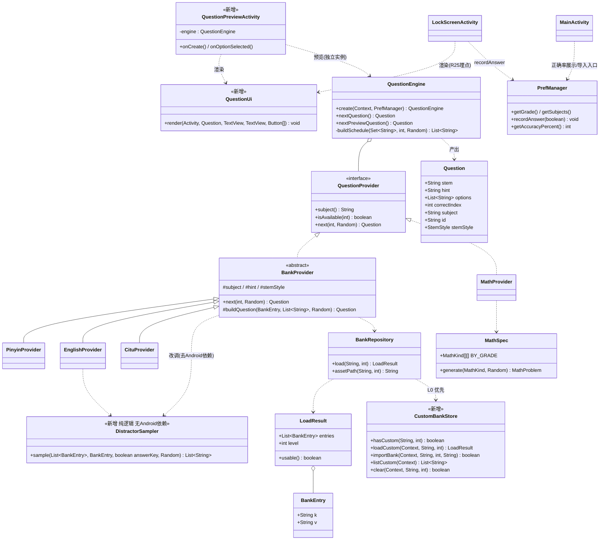
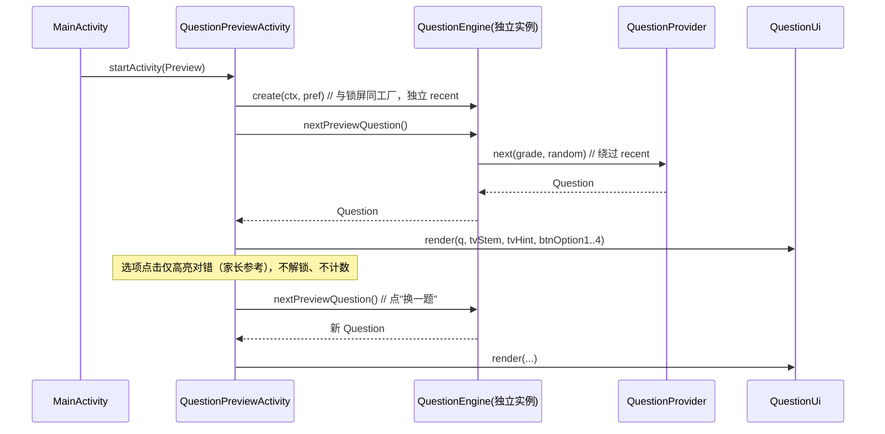
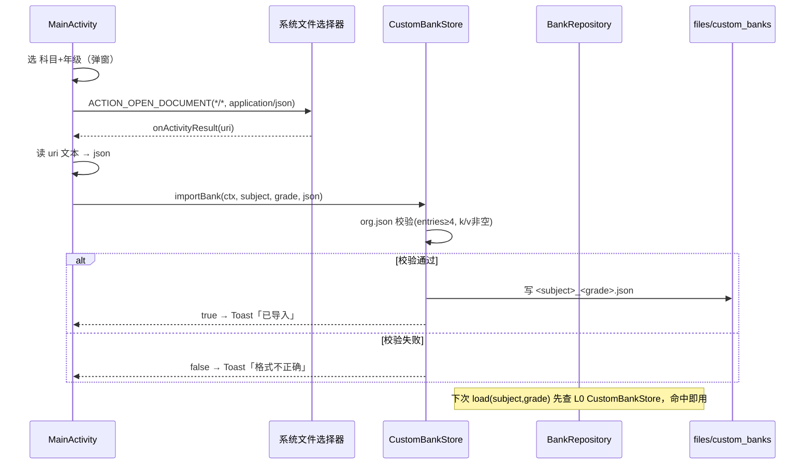
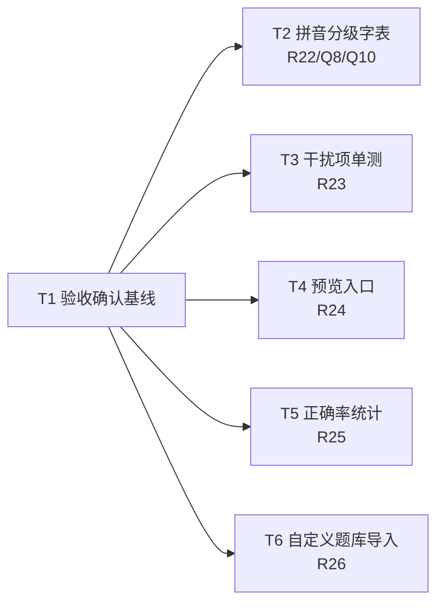

# 规划：KidsLock 多科目分级题库「后续迭代」架构与任务分工

| 项 | 内容 |
|---|---|
| 文档类型 | 后续迭代架构规划 + 任务分解（可直接派工） |
| 输入来源 | `docs/PRD-多科目分级题库.md`（P1/P2 需求池 + 第 5 节 Q6–Q11）、`docs/设计-多科目分级题库.md`（上一期已落地设计 T01–T05）、本仓库现有出题层代码 |
| 代码基线 | `question/`（QuestionEngine / QuestionProvider / BankProvider / *Provider / BankRepository / PrefManager 出题相关部分）、`MainActivity`、`LockScreenActivity` |
| 平台 | Android TV + 平板，纯 Java，minSdk 21 / targetSdk 33 / compileSdk 34 |
| 作者 | 高见远（架构） |
| 读者 | 主理人（拍板 Q6–Q11）/ 工程师（派工） |
| 范围 | 只改出题层与设置页。**不动**计时/防绕过（LockService、RecoveryAccessibilityService、BootReceiver、AlarmReceiver，及 PrefManager 计时对账部分） |

---

## 0. 范围与基线确认

### 0.1 本轮范围来源

- PRD P1 需求池（R19 / R20 / R21 / R22 / R23 / R28）+ P2 需求池（R24 / R25 / R26）+ PRD 第 5 节未拍板问题 **Q6–Q11**（Q1–Q5、Q9 已随决策闭合）。
- 注：PRD 把 R19/R20/R21/R28 计为 P1、R24/R25/R26 计为 P2；本文在 §8 就 Q11 给出「**提前到 P1**」的推荐。

### 0.2 已落地基线（本轮「验收/确认」，不再重新实现）

经代码核对，以下条目**已在上一期（T01–T05）落地**，本轮仅做验收确认：

| 条目 | 落地证据 |
|---|---|
| 多科目分级（Grade 0–6 默认 3 / Subject 4 科默认 pinyin+math） | `PrefManager.java` 第 57–80、362–443 行；`Grade.java`、`Subject.java` |
| QuestionEngine 永不 null + 三级兜底 + 科目顺序表 | `QuestionEngine.java`；`verify_schedule.py` 45 场景全 PASS |
| 英语正反向混合（R10+R20 合并） | `EnglishProvider.next` 按 `random.nextBoolean()` 选方向，id 带 `fwd`/`rev` 前缀 |
| 低年级英语可用性（R21） | `english_0..6.json` 七级齐全；`EnglishProvider.isAvailable` 委托 `BankRepository.load`，无年级下限常量、无静默超纲 |
| 语文科目（R27+R28） | `CituProvider` + `ciyu_0..6.json` 七级齐全，仅正向 |
| **R19 底部文案** | 当前 `strings.xml` 的 `desc_bottom` =「解锁需连续答对对应年级与科目的题目」，**已是年级/科目无关的通用表述** |

> `git log` 可证 T01–T05 全部 commit 完成。

### 0.3 本轮真正的新增 / 改动点

| 条目 | 现状 | 本轮动作 |
|---|---|---|
| R22 拼音低年级字表分级细化 | **未做**：仅 `pinyin_5.json` 存在，0–4/6 年级经 `BankRepository` L2 全部回退到五年级字表（即低龄孩子实际在答五年级字） | 新建分级字表 `pinyin_0..6.json` + 生成脚本 + 构建校验 |
| R23 干扰项质量自动化校验 | **未做**：无任何单测 | 抽取无 Android 依赖的干扰项采样工具 + JUnit 单测（覆盖 7 年级 × 4 科目） |
| R24 预览一道题（P2） | **未做** | 预览 Activity 复用引擎 + 锁屏渲染；本文推荐提前到 P1 |
| R25 答题正确率统计（P2） | **未做** | PrefManager 计数器 + 锁屏埋点 + 设置页展示 |
| R26 家长导入自定义题库（P2，最大） | **未做** | SAF 选文件 + 应用内存储 + `BankRepository` L0 优先 |

---

## 1. 实现方案与框架选型

### 1.1 技术难点与对策（延续上一期「零新增依赖、纯 Java」原则）

| # | 难点 | 对策 |
|---|---|---|
| D1 | R22 要给 0–6 七个年级各编一份拼音字表，且必须与「永不无题可出」契约共存 | 仍走现有 `BankProvider` + `BankRepository` 三级兜底：新增的 `pinyin_0..6.json` 直接作为 L1；任一缺失年级仍由 L2 相邻年级回退（仅当真缺文件时），不破坏 D4 |
| D2 | R23 单测要能验证「干扰项来自同池、无占位、量级相符」，但 `BankProvider` 内联采样逻辑依赖 `BankRepository`(需 Android `AssetManager`) | 抽取 `DistractorSampler`（纯 Java，仅用 `BankEntry`/`List`/`Random`）承载「抽条目→同池取 3 干扰项→洗牌」，**无 Android 依赖**，JVM 单测直接喂内存列表调用；`BankProvider`/`EnglishProvider` 改调它（DRY + 可测） |
| D3 | R24 预览「不计入防重复队列」但又要复用真实出题 | 预览 Activity 用**独立** `QuestionEngine` 实例（其 `recent` 队列天然与锁屏实例隔离）；再额外提供 `nextPreviewQuestion()` 显式绕过 recent，契约更清晰 |
| D4 | R26 自定义题库运行期导入，但 assets 只读 | `CustomBankStore` 把导入的题库写入 `getFilesDir()/custom_banks/<subject>_<grade>.json`；`BankRepository.load` 新增 **L0 自定义优先**层（在 L1 资产之前），校验失败回退到现有 L1–L3 |
| D5 | R25 正确率埋点不能触碰计时对账 | 仅在 `LockScreenActivity.onOptionSelected` 调 `PrefManager.recordAnswer(bool)`；新增 key 与计时对账 key 同文件但互不相干，绝不改动 `deductOfflineIfAny` 等计时逻辑 |

### 1.2 选型表

| 决策点 | 选型 | 理由 |
|---|---|---|
| 语言 / 框架 | 沿用纯 Java + Android 框架自带 `org.json` / `AssetManager` | 不引入新库、不引入 native；与现状一致 |
| 单测框架（R23） | `testImplementation 'junit:junit:4.13.2'`（**test-only，不进 APK**） | 本期唯一新增依赖；JVM 单测无需 Robolectric（见 D2） |
| 自定义题库导入（R26） | 系统 SAF `Intent.ACTION_OPEN_DOCUMENT` | 无需第三方文件选择器；用户从任意位置选 `.json` |
| 预览渲染（R24） | 复用锁屏布局 + 抽出 `QuestionUi.render` | 不另起一套渲染，避免双份布局漂移 |
| 架构模式 | 沿用分层 `UI → QuestionEngine → Provider → BankRepository/MathSpec` | 规模小，不引入 MVVM/DI |

### 1.3 与本期硬性约束的对齐

- **禁改清单**：`LockService` / `RecoveryAccessibilityService` / `BootReceiver` / `AlarmReceiver` 及 `PrefManager` 计时对账（`deductOfflineIfAny` 等）一律不碰。R25 只在 `PrefManager` 末尾新增统计 key。
- **构建验证**：任何 Java 改动后必须实跑 `./gradlew assembleDebug --offline`（JDK17 在 `.workbuddy/tools/jdk17`）。
- **四处同步**：默认值/规则变更须 **PRD + 设计文档 + README + 代码注释** 一并更新。
- **不可破坏**：出题引擎「永不 null」契约、三级兜底、科目数配置驱动、`verify_schedule.py` 45 场景。

---

## 2. 文件列表（标注【新增】/【修改】）

### 2.1 新增

| # | 文件（相对仓库根） | 职责 |
|---|---|---|
| 1 | `app/src/main/java/com/kidslock/app/question/DistractorSampler.java`【新增】 | 无 Android 依赖的「抽条目→同池取 3 干扰项→洗牌」静态工具，供 `BankProvider`/`EnglishProvider` 与 R23 单测共用 |
| 2 | `app/src/main/java/com/kidslock/app/question/QuestionUi.java`【新增】 | 抽出题目渲染（题干/提示/4 选项/字号档），锁屏与预览共用（R24 DRY） |
| 3 | `app/src/main/java/com/kidslock/app/QuestionPreviewActivity.java`【新增】 | R24 预览一道题；复用引擎 + 锁屏渲染，独立于锁屏实例 |
| 4 | `app/src/main/java/com/kidslock/app/question/CustomBankStore.java`【新增】 | R26 自定义题库的应用内存储、校验与清除 |
| 5 | `app/src/main/assets/banks/pinyin_0.json` … `pinyin_6.json`【新增】 | R22 分级拼音字表（0–6 七级；`pinyin_5.json` 沿用现状 144 条微调，0–4/6 全新生成） |
| 6 | `gen_pinyin_banks.py`【新增】 | R22 生成分级字表（学前=独体字/笔画≤6，一~六逐级对齐识字范围） |
| 7 | `app/src/main/res/layout/activity_question_preview.xml`【新增】 | R24 预览页布局，复用锁屏同名控件 ID（`layoutMain`/`tvCharacter`/`tvQuestionHint`/`btnOption1..4`）+ 预览控制条 |
| 8 | `app/src/test/java/com/kidslock/app/question/DistractorSamplerTest.java`【新增】 | R23 干扰项质量单测（拼音/英语/语文，纯 JVM） |
| 9 | `app/src/test/java/com/kidslock/app/question/MathProviderTest.java`【新增】 | R23 数学干扰项质量单测（7 年级） |
| 10 | `app/src/test/java/com/kidslock/app/question/ScheduleTest.java`【新增】 | R23 镜像 `QuestionEngine.buildSchedule` 不变量（与 `verify_schedule.py` 互补，Java 侧可执行） |

### 2.2 修改

| # | 文件 | 改动 |
|---|---|---|
| 11 | `app/src/main/java/com/kidslock/app/question/BankProvider.java`【修改】 | 内联采样改为调用 `DistractorSampler.sample(...)`；`buildSchedule` 可见性由 `private` 改 `package-private`（供 `ScheduleTest`） |
| 12 | `app/src/main/java/com/kidslock/app/question/EnglishProvider.java`【修改】 | 删除私有 `sampleOptions`，改调 `DistractorSampler` |
| 13 | `app/src/main/java/com/kidslock/app/question/BankRepository.java`【修改】 | `loadInternal` 增加 **L0 自定义优先**（`CustomBankStore.hasCustom` 命中且可用则直接返回，打 `Log.i`）；`assetPath` 仍唯一入口 |
| 14 | `app/src/main/java/com/kidslock/app/question/QuestionEngine.java`【修改】 | 新增 `nextPreviewQuestion()`：直接 `provider.next(grade, random)`，绕过 `recent` 队列 |
| 15 | `app/src/main/java/com/kidslock/app/LockScreenActivity.java`【修改】 | `loadNextQuestion` 渲染改调 `QuestionUi.render(...)`；`onOptionSelected` 增加 `pref.recordAnswer(correct)`（R25） |
| 16 | `app/src/main/java/com/kidslock/app/MainActivity.java`【修改】 | 新增预览按钮（R24）、正确率展示（R25）、导入自定义题库入口（R26）的监听与 `updateStatus` 补充 |
| 17 | `app/src/main/java/com/kidslock/app/PrefManager.java`【修改】 | 新增正确率计数器 key（`stat_correct`/`stat_total`）+ `recordAnswer`/`getAccuracyPercent`；**不触碰计时对账** |
| 18 | `app/src/main/res/layout/activity_main.xml`【修改】 | 「出题设置」区内新增预览按钮、正确率 `TextView`、导入入口（位于科目区之后、`btnGuardStatus` 之前） |
| 19 | `app/src/main/res/values/strings.xml`【修改】 | 新增预览/正确率/导入相关文案 |
| 20 | `app/src/main/res/values/dimens.xml`【修改】 | 如有新尺寸（预览控制条） |
| 21 | `app/build.gradle`【修改】 | 增加 `testImplementation 'junit:junit:4.13.2'`（R23）；`verifyQuestionBanks` 扩展校验 `pinyin_0..6.json`（R22/Q8，年级感知下限） |
| 22 | `README.md` / `docs/PRD-多科目分级题库.md` / `docs/设计-多科目分级题库.md`【修改】 | 同步默认值/规则变更（约束要求） |

**汇总：新增 10、修改 12。**

---

## 3. 数据结构与接口

### 3.1 类图



### 3.2 关键接口签名

```java
// ---- DistractorSampler.java（R23 可测核心，无 Android 依赖）----
public final class DistractorSampler {
    /**
     * 从同池取 3 个与 chosenVal 不同且互不相同的候选，拼成 4 选项（含正确项），洗牌返回。
     * @param answerKey false→以 v 为正确项取值（拼音/语文正向、英语正向）；
     *                  true →以 k 为正确项取值（英语反向）。
     * 候选去重后 < 3 → 返回 null（绝不占位）。
     */
    @Nullable
    public static List<String> sample(@NonNull List<BankEntry> pool,
                                      @NonNull BankEntry chosen, boolean answerKey,
                                      @NonNull Random random);
}

// ---- QuestionUi.java（R24 渲染复用）----
public final class QuestionUi {
    public static void render(@NonNull Activity act, @NonNull Question q,
                             @NonNull TextView tvStem, @NonNull TextView tvHint,
                             @NonNull Button[] optionButtons);
}

// ---- QuestionEngine.java（R24 预览）----
public final class QuestionEngine {
    public static QuestionEngine create(Context ctx, PrefManager pref);
    public Question nextQuestion();                 // 永不 null、绕 recent 队列
    /** 预览专用：直接 provider.next，绝不触碰 recent 队列（R24「不计入防重复」） */
    @NonNull
    public Question nextPreviewQuestion();
}

// ---- CustomBankStore.java（R26）----
public final class CustomBankStore {
    public static boolean hasCustom(String subject, int grade);
    @Nullable
    public static BankRepository.LoadResult loadCustom(Context ctx, String subject, int grade);
    /** 校验 schema + 条目 ≥ 4 + k/v 非空；成功写入 files/custom_banks/<s>_<g>.json。失败返回 false，绝不抛 */
    public static boolean importBank(Context ctx, String subject, int grade, String json);
    public static List<String> listCustom(Context ctx);
    public static boolean clear(Context ctx, String subject, int grade);
}

// ---- PrefManager.java（R25 正确率，不碰计时对账）----
public void recordAnswer(boolean correct);   // total++；correct 时 correct++
public int getStatTotal();
public int getStatCorrect();
public int getAccuracyPercent();             // total==0 → -1，否则 round(100*correct/total)
```

### 3.3 防重复与预览隔离

- 预览使用**独立** `QuestionEngine` 实例，其 `recent` 队列与锁屏实例天然隔离；再叠加 `nextPreviewQuestion()` 显式不走 recency，双重保证「预览不污染真实防重复队列」（PRD R24）。
- 题目 ID 格式沿用：`pinyin:<汉字>` / `math:...` / `english:fwd|rev:<k>` / `ciyu:<词>`（见设计 §3.3），预览题 id 不再入队。

---

## 4. 程序调用流程

### 4.1 预览一道题（R24）



> 预览按钮位于设置页 `设置出题` 区内，而设置页整体处于**家长 PIN 门禁之后**（`layoutSettings` 在 `gateVerified` 前 `GONE`），故「过 PIN 门禁」已由现有门禁天然满足；无需额外加锁。

### 4.2 自定义题库导入（R26）



### 4.3 正确率统计（R25）

```mermaid
sequenceDiagram
    participant LSA as LockScreenActivity
    participant PM as PrefManager
    participant MA as MainActivity

    LSA->>LSA: onOptionSelected(index)
    LSA->>LSA: correct = (index==q.correctIndex)
    LSA->>PM: recordAnswer(correct)  // total++; 命中则 correct++
    Note over LSA: 后续解锁/清零逻辑不变
    MA->>PM: getAccuracyPercent()    // 设置页 updateStatus
    PM-->>MA: -1(无数据) 或 百分比
    MA->>MA: tvAccuracy 显示「累计正确率 xx%」
```

---

## 5. 任务列表（有序、含依赖、按实现顺序）

> 共 6 个任务，T1 为验收确认，T2–T6 为新增/改动。T2–T6 均只依赖 T1（基线），彼此独立可并行派工；其中 T3（单测）与 T2（资产）共享「资产阈值」约定，建议 T2 先定阈值再开 T3。

### T1 — 验收确认已落地基线（无代码改动）

| 项 | 内容 |
|---|---|
| **源文件** | 仅核对：`PrefManager.java`、`QuestionEngine.java`、`EnglishProvider.java`、`CituProvider.java`、`english_0..6.json`、`ciyu_0..6.json`、`strings.xml`(`desc_bottom`) |
| **依赖** | 无 |
| **优先级** | 验收/确认（P0 基线） |
| **要点** | 逐项确认 §0.2 表格已落地；在 `docs/设计-多科目分级题库.md` 标注「R19/R20/R21/R27/R28 已验收」；不写新代码 |
| **验收** | 代码 grep + 真机进入锁屏确认英语正反向混合出现、语文正向出现、底部文案已中性化 |

### T2 — 拼音分级字表资产（R22 + Q8 + Q10-A）【P1】

| 项 | 内容 |
|---|---|
| **源文件** | 【新增】`assets/banks/pinyin_0..6.json`（其中 5 沿用微调）、`gen_pinyin_banks.py`；【修改】`app/build.gradle`（`verifyQuestionBanks` 扩展） |
| **依赖** | T1 |
| **优先级** | P1 |
| **要点** | ① 学前（0）= 独体字 / 笔画 ≤ 6 的高频字；一~六逐级对齐对应年级识字范围（参考小学语文识字表）；② 每级 `distinct(v) ≥ 4`；③ 构建校验下限：**学前 ≥ 60，一~六 ≥ 100**（见 §8 Q8 推荐）；④ `pinyin_5.json` 维持与 `BuiltinPinyinBank` 逐条一致（L3 兜底不可漂移）；⑤ `gen_pinyin_banks.py` 生成后需人工抽验每级 20 条在对应年级认知内（R22 验收） |
| **验收** | `./gradlew assembleDebug --offline` 通过；`verifyQuestionBanks` 对 7 个拼音文件全 PASS；低龄（学前/一年级）经 L1 直接命中本级字表、不再回退到五年级 |

### T3 — 干扰项质量单测（R23）【P1】

| 项 | 内容 |
|---|---|
| **源文件** | 【新增】`DistractorSampler.java`、`question/DistractorSamplerTest.java`、`question/MathProviderTest.java`、`question/ScheduleTest.java`；【修改】`BankProvider.java`、`EnglishProvider.java`、`QuestionEngine.java`(`buildSchedule` 可见性)、`app/build.gradle`(junit) |
| **依赖** | T1（建议 T2 定阈值后开工） |
| **优先级** | P1 |
| **要点** | ① `DistractorSampler` 抽出后 `BankProvider`/`EnglishProvider` 改调（行为不变）；② 单测覆盖：**拼音 / 英语 / 语文**（用内存构造 `List<BankEntry>` 喂 `sample`）+ **数学 7 年级**（`MathProvider.next` 传 `null` context，其 `next` 路径不触碰 context）；③ 断言：选项恒 4、文本互异、干扰项 ≠ 正确项、数学干扰项与正确值**位数差 ≤ 1**；④ `ScheduleTest` 镜像 `buildSchedule` 不变量（每科 ≥1 / N>5 上限 ⌈N/M⌉）；⑤ 资产「每级条目/去重数下限」由 `verifyQuestionBanks`（构建期）把关，与单测（算法正确性）职责分离 |
| **验收** | `./gradlew testDebugUnitTest --offline` 全 PASS；`./gradlew assembleDebug --offline` 仍通过（抽工具不改行为） |

### T4 — 预览一道题入口（R24，推荐提前到 P1）【P1】

| 项 | 内容 |
|---|---|
| **源文件** | 【新增】`QuestionPreviewActivity.java`、`question/QuestionUi.java`、`res/layout/activity_question_preview.xml`；【修改】`QuestionEngine.java`(`nextPreviewQuestion`)、`MainActivity.java`、`activity_main.xml`、`strings.xml` |
| **依赖** | T1 |
| **优先级** | P1（原 P2，Q11 推荐提前，见 §8） |
| **要点** | ① 预览按钮置于设置页出题区内（已在 PIN 门禁之后，天然过门禁）；② 复用 `QuestionUi.render` 渲染一道题；选项点击仅高亮对错、不解锁不计数；③ 用独立 `QuestionEngine` + `nextPreviewQuestion()` 保证「不计入防重复队列」；④ 提供「换一题 / 关闭」控制 |
| **验收** | 设置页点预览 → 显示当前年级/科目下一道题；连点换题不出现重复抑制异常；退出后锁屏真实防重复队列不受影响 |

### T5 — 答题正确率统计（R25）【P2】

| 项 | 内容 |
|---|---|
| **源文件** | 【修改】`PrefManager.java`(新增统计 key + `recordAnswer`/`getAccuracyPercent`)、`LockScreenActivity.java`(`onOptionSelected` 埋点 + 渲染改 `QuestionUi`)、`MainActivity.java`(`updateStatus` 展示)、`activity_main.xml`、`strings.xml` |
| **依赖** | T1（与 T4 共享 `QuestionUi` 抽取，建议同期） |
| **优先级** | P2 |
| **要点** | ① 累计计数 `stat_correct`/`stat_total`，跨会话持久化；② `recordAnswer` 仅在判题时调用，**不触碰计时对账**；③ 设置页 `tvAccuracy` 显示「累计正确率 xx%」（total==0 时隐藏）；④ 不在锁屏界面暴露数值（防孩子针对） |
| **验收** | 连续作答后设置页正确率随作答更新；`assembleDebug --offline` 通过；计时/防绕过回归无变化 |

### T6 — 家长导入自定义题库（R26）【P2，最大】

| 项 | 内容 |
|---|---|
| **源文件** | 【新增】`question/CustomBankStore.java`；【修改】`BankRepository.java`(L0)、`MainActivity.java`(导入入口 + 科目/年级选择 + SAF 回调)、`activity_main.xml`、`strings.xml` |
| **依赖** | T1 |
| **优先级** | P2（工作量与风险最大，可最后排期；建议 MVP 仅支持拼音/英语/语文三类「题库型」科目，数学为代码生成不支持导入） |
| **要点** | ① `CustomBankStore` 写入 `getFilesDir()/custom_banks/<subject>_<grade>.json`，导入时严格校验 schema + 条目 ≥ 4 + k/v 非空，失败返回 false 绝不抛；② `BankRepository.load` L0 自定义优先（命中且可用即返回，打 `Log.i`），失败透明回退 L1–L3，绝不破坏「永不 null」；③ 导入流程：设置页入口 → 选科目+年级 → `ACTION_OPEN_DOCUMENT` 选 `.json` → 校验写入 → Toast；并提供「清除自定义题库」；④ 自定义题库**增强**既有科目（同一 schema），不新增科目、不破坏科目数配置驱动 |
| **验收** | 导入合法 json 后该 (科目,年级) 出题即来自自定义内容；导入非法文件被拒且不影响原有出题；删除全部 assets 极端场景下仍由 L3 兜底非 null；`assembleDebug --offline` 通过 |

### 5.1 任务依赖图



### 5.2 派工建议

- **第 1 批**：T1（验收，零代码）→ T2（资产，定阈值，独立于 UI）。
- **第 2 批（并行）**：T3（单测）、T4（预览）、T5（正确率）、T6（导入）。
- **收尾**：真机回归（MiTV4A + 荣耀平板）跑：低龄字表不再超纲（R22）、预览不污染队列（R24）、正确率更新（R25）、导入/清除（R26）、`verify_schedule.py` 45 场景仍全 PASS、`assembleDebug --offline` 通过。

---

## 6. 依赖包列表

**仅一处新增，且为 test-only，不进 APK**：

| 用途 | 方案 | 是否新增 |
|---|---|---|
| 单测（R23） | `testImplementation 'junit:junit:4.13.2'` | **是（test 域，不进 APK）** |
| JSON 解析 | Android 自带 `org.json.*` | 否 |
| assets 读取 | `android.content.res.AssetManager` | 否 |
| 自定义题库导入 | 系统 SAF `ACTION_OPEN_DOCUMENT` | 否（无需第三方选择器） |
| 构建期资产校验 | Gradle 自带 `groovy.json.JsonSlurper` | 否 |
| 渲染/预览复用 | 现有 `activity_lock_screen` 控件 ID + `QuestionUi` | 否 |

现有依赖保持不变：`androidx.appcompat:appcompat:1.6.1`、`androidx.constraintlayout:constraintlayout:2.1.4`、`com.google.android.material:material:1.11.0`。

---

## 7. 共享知识（跨文件约定，工程师必读）

1. **出题层接入契约**：新科目/新题型优先复用 `BankProvider`（题库型）或 `MathProvider`/`MathSpec`（生成型），实现 `QuestionProvider` 三方法；`next()` 失败返回 `null` 绝不抛、绝不占位；引擎「永不 null」靠三级兜底 + L3 `BuiltinPinyinBank` 守底。
2. **`DistractorSampler` 无 Android 依赖**：所有「同池取干扰项」逻辑集中此处，便于 JVM 单测；`BankProvider`/`EnglishProvider` 不得再内联采样。
3. **科目数配置驱动**：新增科目只需在 `Subject.ORDER`/`PHASE_ALLOWED` + `QuestionEngine.create` 的 `if` 链 + `buildSchedule` 的 `canAdd` 三处同步；禁止硬编码科目数。
4. **资产阈值（构建期把关）**：拼音 学前 ≥ 60 / 一~六 ≥ 100 条且 `distinct(v) ≥ 4`；英语/语文每级 ≥ 60 且 `distinct(v) ≥ 4`；`pinyin_5.json` 必须与 `BuiltinPinyinBank` 逐条一致（`verifyQuestionBanks` 比对）。
5. **自定义题库阈值（运行期把关）**：`CustomBankStore.importBank` 要求 `entries ≥ 4` 且 k/v 非空；低于此直接拒收，绝不静默降级。
6. **预览与真实队列隔离**：预览用独立 `QuestionEngine` 实例 + `nextPreviewQuestion()`；任何「不计入防重复」的需求都走此通道。
7. **默认值/规则四处同步**：任何默认年级/科目/题数或出题规则的变更，必须同步 **PRD + 设计文档 + README + 代码注释** 四处。
8. **禁改清单**：`LockService`/`RecoveryAccessibilityService`/`BootReceiver`/`AlarmReceiver` 及 `PrefManager` 计时对账（`deductOfflineIfAny` 等）严禁改动；R25 只在 `PrefManager` 末尾新增统计 key。
9. **构建验证（硬门槛）**：任何 Java 改动后必须实跑 `export JAVA_HOME=.workbuddy/tools/jdk17 && export PATH="$JAVA_HOME/bin:$PATH" && ./gradlew assembleDebug --offline`；R23 另跑 `./gradlew testDebugUnitTest --offline`。
10. **日志 TAG**：出题层统一 `KidsLock-Question`；三级兜底每级打日志（L1 不打 / L2 `Log.w` / L3 `Log.e`）；自定义 L0 用 `Log.i`。

---

## 8. 待明确事项（Q6–Q11 架构师推荐值，供主理人拍板）

| # | 问题 | 架构师推荐 | 取舍与理由 |
|---|---|---|---|
| **Q6** | 年级按钮标签：极简 vs 全称 | **A（极简短标 `学前/一/二/三/四/五/六` 单行），确认即可** | 已按 A 实现并通过 1080p TV / 1280×800 平板宽度核算（≤712dp）。全称两行 `GridLayout` 需重做焦点链、收益低。无需改动 |
| **Q7** | 数学五/六年级参数 | **接受 PRD R09-表拆分值**（五=两步混合+小数加减；六=三步混合+分数+小数乘除） | 已落地于 `MathSpec.BY_GRADE[5]/[6]`，数值集中在 `MathSpec` 一处，改动成本 = 改一张表。产品侧建议值合理，确认即可 |
| **Q8** | 拼音字表规模下限 | **学前 ≥ 60，一~六 ≥ 100，去重拼音 ≥ 4** | 100 维持与现有 `pinyin_5=144` 同量级，保证干扰项池健康；学前独体字/笔画≤6 字源有限，降到 60 减轻编校负担且仍 ≥4 去重。构建脚本年级感知（见 T2） |
| **Q10** | 低龄孩子不认识题干汉字是否可接受 | **A（接受，字表限定在同年级识字范围内）** | 与 **R22 绑定解决**：一旦 `pinyin_0..6.json` 各级用适龄字（学前=独体字），「不认识」风险即最小化。选 B（低龄不出拼音）会让学前只剩数学，不推荐 |
| **Q11** | 预览题目是否提前到本期 | **推荐提前到 P1（原 P2）** | R24 仅复用现有引擎 + 锁屏渲染，且设置页已整体处于 PIN 门禁之后，「过门禁」零成本；能显著降低家长配置焦虑，风险极低、收益高。建议把 T4 从 P2 提至 P1 |
| 补充 | R19/R20/R21/R27/R28 | **已落地，无需再议** | 见 §0.2，本轮仅验收确认 |

> 若主理人认可上述推荐，Q6/Q7/Q10 可直接「确认」，Q8/Q11 按推荐值落地；本规划据此将 T4 列为 P1、T2 资产下限设为「学前 60 / 一~六 100」。

---

## 附：验证命令（硬门槛）

```bash
cd /d/soft/myapp/kidslock
export JAVA_HOME=/d/soft/myapp/kidslock/.workbuddy/tools/jdk17
export PATH="$JAVA_HOME/bin:$PATH"
./gradlew assembleDebug --offline          # 任何 Java 改动后必跑
./gradlew testDebugUnitTest --offline      # R23 单测（T3 完成后）
python verify_schedule.py                 # 45 场景不变量（不可破坏）

---

## 9. 主理人决策确认（2026-10-14）

主理人已确认 §8 全部推荐值，规划据此定稿：

| # | 决策 | 状态 |
|---|---|---|
| Q6 | 采用极简短标 `学前/一/二/三/四/五/六` | ✅ 确认 |
| Q7 | 接受 PRD R09 五/六年级数学参数 | ✅ 确认 |
| Q8 | 拼音字表下限：学前 ≥60、一~六 ≥100、distinct(v)≥4 | ✅ 确认 |
| Q10 | 接受（字表限定适龄字），由 R22 化解 | ✅ 确认 |
| Q11 | R24 预览从 P2 提前到 P1 | ✅ 确认 |
| R19/R20/R21/R27/R28 | 已落地，仅验收确认 | ✅ 确认 |

**据此定稿的派生结论**：
- T4（预览）优先级由 P2 调整为 **P1**；
- T2（拼音分级字表）资产下限设为「学前 60 / 一~六 100」；
- Q6/Q7/Q10 无需代码改动，仅在 T1 验收时核对。
```
