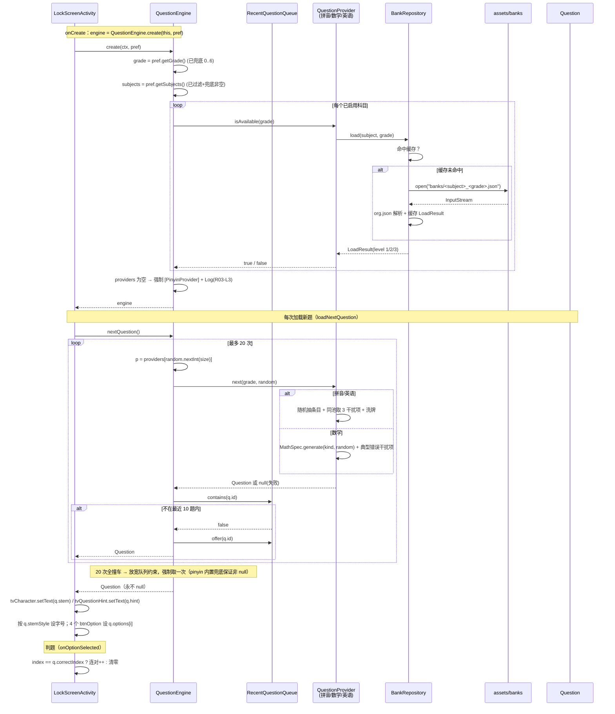
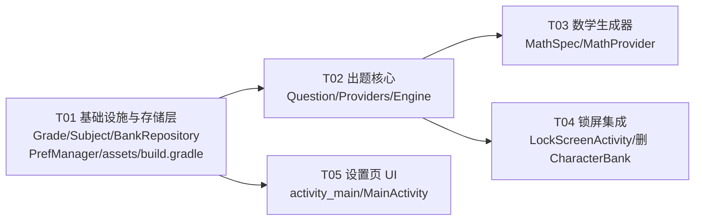

# 系统设计：多科目分级题库

| 项 | 内容 |
|---|---|
| 文档类型 | 系统设计 + 任务分解（可直接派工） |
| 上游输入 | `docs/PRD-多科目分级题库.md`（26 条需求，P0×18 / P1×5 / P2×3）— **需求权威源**；`方案-多科目分级题库.md`（架构草案，PRD 已指出 5 处不完整，以 PRD 为准） |
| 代码基线 | `CharacterBank`（144 条）、`LockScreenActivity`、`MainActivity`、`PrefManager`、`activity_main.xml`、`activity_lock_screen.xml` |
| 平台 | Android TV + 平板，纯 Java，minSdk 21 / targetSdk 33 / compileSdk 34 |
| 作者 | 高见远（架构） |
| 读者 | 工程师 |
| 范围 | **只改出题层与设置页**。不动计时/防绕过（LockService、RecoveryAccessibilityService、BootReceiver、AlarmReceiver、PrefManager 计时对账） |

---

## 0. 本期范围收敛（对齐 PRD 决策 D1–D4）

> 本文由架构师高见远产出，团队负责人在限流窗口期复核并据此收敛范围。以下为**本期（P0）权威范围**，覆盖 PRD D1–D4：

- **科目**：本期 `pinyin`（拼音）+ `math`（数学）+ `english`（英语）+ `ciyu`（语文·词语/成语）四项。`english` 经 **D3 修订**已落地本期：七级通用词表 `english_0..6.json` 随包下发、`EnglishProvider` 已实现（正向看英文选中文 + 反向看中文选英文混合）、设置页出现英语按钮；`ciyu` 经 **D5 修订**已落地本期：七级词表 `ciyu_0..6.json` 随包下发、`CituProvider` 已实现（仅正向看词语/成语选拼音）、设置页出现语文按钮；英语 / 语文均**默认关闭**，仅 `pinyin` 启用（D2 不变）。
- **题库资产**：本期随包下发 `pinyin_5.json`（144 条，与 `BuiltinPinyinBank` 一字不差）+ `english_0..6.json`（七级通用小学词表，每级 ≥ 60 条）+ `ciyu_0..6.json`（七级通用小学词语/成语词表，每级 ≥ 60 条，与拼音/英语共用统一 Schema）。拼音其余年级（0–4、6）无数据，经 `BankRepository` 的 L2 相邻年级合并回退到 5 年级出题（接受 **D4** 偶发超纲）；英语 / 语文各年级均独立成表，无合并超纲。
- **默认值**：年级默认三年级（`D1`，D6 修订：原五年级）、科目默认拼音 + 数学（`D2`，D6 修订：原仅拼音；英语/语文默认关闭），新装与升级同路径，无分支；存量用户存储值恰为旧默认（年级 5 / 科目 pinyin）经 `migrateLegacyDefaults()` 一次性迁移到新默认。
- **兜底**：题库不足三级兜底（L1 同年级 → L2 相邻年级合并 → L3 拼音 → 内置 144 条）与「至少启用一科」三层防护不变（PRD R03/R13）。

> 文中涉及 `EnglishProvider`、`english_*.json`、`btnSubjectEnglish` 的描述**本期已落地**（D3 修订）：已实现、随包下发、设置页已出现，详见 §2 / §6。

---

## 1. 实现方案与框架选型

### 1.1 技术难点与对策

| # | 难点 | 对策 |
|---|---|---|
| D1 | 锁屏界面目前硬耦合 `CharacterBank`（`bank = new CharacterBank()`），换成多科目不能破坏"答错清零 / 连对解锁 / PIN 逃生"三条既有路径 | 引入 `QuestionEngine` 作为**唯一**出题入口，`LockScreenActivity` 只依赖 `Question` 数据类渲染，判题从"字符串比较"改为"索引比较"，Activity 内**零科目分支** |
| D2 | 干扰项是安全设计的一部分，占位/异常值会把 4 选 1 降成 3 选 1 | 拼音/英语干扰项沿用 `CharacterBank.getDistractors` 的"同池取样 + 不足即失败"原则；数学干扰项按 PRD R09-表的"典型错误"优先级构造；**任何一级凑不齐 3 个就让本次出题失败（返回 null）换 provider 重抽，绝不补占位** |
| D3 | 题库不足 / JSON 损坏 / prefs 被篡改时，孩子会被无限锁死 | 三级兜底 L1 同年级 → L2 相邻年级合并 → L3 拼音 → 内置 144 条；**兜底链的最后一环是编译进 dex 的 Java 常量数组，不可能缺失**。`QuestionEngine.nextQuestion()` 契约：永不返回 null、永不抛异常 |
| D4 | TV 遥控器只有方向键 + 确认键 | 科目多选不用 CheckBox/Switch，用"按钮组 + 确认键 toggle"；选中态走**文字通道**（`✓数学` + 绿色），不复用 `btn_settings_bg` 的 `state_selected`（该 selector 的 `state_focused` 排首位会盖掉选中态，已核对 `drawable/btn_settings_bg.xml` 第 3~9 行） |
| D5 | 五年级字表必须与现状一字不差（升级零回归） | 144 条同时以两种形态存在：`assets/banks/pinyin_5.json`（正常路径）与 `BuiltinPinyinBank.java`（L3 兜底）；**构建期校验任务逐条比对两者，不一致即构建失败** |
| D6 | 零新增依赖前提下做构建期资产校验 | Gradle 自定义任务使用 **Groovy 内置的 `groovy.json.JsonSlurper`**（Gradle 自带，不进 APK、不新增任何 dependency），挂到 `preBuild` |

### 1.2 选型表

| 决策点 | 选型 | 理由 |
|---|---|---|
| JSON 解析 | Android 框架自带 `org.json`（`JSONObject`/`JSONArray`） | 零新增依赖；几百条数据的解析耗时 < 5 ms，且结果缓存，性能无压力 |
| 资产读取 | `context.getAssets().open("banks/xxx.json")` | 只读、随 APK 打包、无需运行时权限 |
| 构建期校验 | Gradle `DefaultTask` + `groovy.json.JsonSlurper` + 正则读 Java 源文件 | 与 JVM 测试框架解耦，CI（ubuntu-latest）与本机 Windows 都能跑，零依赖 |
| 数学题 | 纯代码生成（`long` 定点整数运算，**不用 double**） | 避免浮点误差导致"正确答案不在选项里"；无限不重复、零体积 |
| 科目存储 | SharedPreferences `String`（CSV，如 `pinyin,math`），对外 API 暴露 `Set<String>` | `getStringSet` 返回可变集合引用且难在 adb 里手写脏数据测试；CSV 易读易诊断，`getSubjects()` 内部做过滤 + 兜底 |
| 包结构 | 新增子包 `com.kidslock.app.question` | 现有 8 个类平铺在 `com.kidslock.app`，再塞 14 个类会失控；子包划出清晰的出题层边界 |
| 随机数 | `QuestionEngine` 持有单个 `java.util.Random`，传给 provider | 与现状 `CharacterBank` 自带 `Random` 语义一致；便于单测注入固定 seed |
| 架构模式 | 无框架，分层：`UI(LockScreenActivity/MainActivity) → QuestionEngine → QuestionProvider[] → BankRepository/MathSpec` | 项目规模小（~2500 行），引入 MVC/MVVM 只会增加抽象成本 |

### 1.3 分层结构

```
MainActivity (设置页)  ──写──>  PrefManager ──读──>  QuestionEngine
                                                        │
LockScreenActivity (答题) ──nextQuestion()──>  QuestionEngine
                                                        │
                          ┌─────────────────────────────┼─────────────────────┐
                          ▼                             ▼                     ▼
                    PinyinProvider               EnglishProvider         MathProvider
                          └────── BankProvider（共用同池取样/洗牌/建题）──────┘        │
                                       │                                              │
                                  BankRepository（assets IO + 内存缓存 + 三级兜底）  MathSpec（年级参数表）
                                       │
                                  BuiltinPinyinBank（144 条内置兜底）
```

### 1.4 assets 目录与命名约定

```
app/src/main/assets/banks/
    pinyin_0.json  …  pinyin_6.json      # 年级编码 0=学前 1..6=一年级..六年级
    english_3.json …  english_6.json     # 英语起始年级见 Q4；文件缺失=该年级不可用
```

**命名规则**：`<subject>_<gradeCode>.json`，全小写、下划线分隔。`subject` 取值为 `pinyin` / `math` / `english` / `ciyu`（数学无资产文件）。路径拼接集中在 `BankRepository.assetPath(subject, grade)` 一处，禁止在别处拼字符串。

**统一 Schema**（拼音与英语共用同一解析器，`k` = 题干、`v` = 正确选项）：

```json
{
  "subject": "pinyin",
  "grade": 5,
  "entries": [
    { "k": "誉", "v": "yù" },
    { "k": "邦", "v": "bāng" }
  ]
}
```

英语为 `{ "k": "apple", "v": "苹果" }`；语文为 `{ "k": "一心一意", "v": "yì xīn yí yì" }`（成语及词语的拼音均带声调、音节间空格）。构建期校验会检查 `entries` 非空、`k`/`v` 非空、`v` 去重后 ≥ 4 种（PRD R12 ③）。

**体积预算**：拼音 7 级 × ≥100 条 ≈ 700 条；英语 7 级 × ≥60 条 ≈ 420 条；语文 7 级 × ≥60 条 ≈ 430 条；单条 ~30 字节 → 合计 < 50 KB，远低于 1 MB 上限（PRD S5）。

---

## 2. 文件清单

### 2.1 新增（Java，全部在 `app/src/main/java/com/kidslock/app/question/`）

| # | 文件 | 职责 |
|---|---|---|
| 1 | `Question.java` | 通用题目模型：题干 + 提示语 + 4 选项 + 正确索引 + 科目标识 + 防重复 ID + 题干字号档位 |
| 2 | `QuestionProvider.java` | 出题接口：`subject()` / `isAvailable(grade)` / `next(grade, random)` |
| 3 | `Grade.java` | 年级常量：0~6 编码、短标/全称标签数组、合法性校验、默认 3（三年级，D6 修订；实际生效默认由 `PrefManager.DEFAULT_QUESTION_GRADE` 驱动） |
| 4 | `Subject.java` | 科目常量：`pinyin`/`math`/`english`/`ciyu`、固定顺序数组、中文名映射、合法性校验 |
| 5 | `BankEntry.java` | 题库条目：`k`（题干）+ `v`（正确选项），拼音/英语共用 |
| 6 | `BankRepository.java` | assets JSON 读取 + 进程内缓存 + 三级兜底（L1/L2/L3）+ 统一日志 |
| 7 | `BankProvider.java` | 抽象基类：拼音与英语共用的"抽条目 → 同池取 3 干扰项 → 洗牌 → 建题" |
| 8 | `PinyinProvider.java` | 拼音题型（看汉字选读音）；L3 内置兜底由其经 BankRepository 触发 |
| 9 | `EnglishProvider.java` | 英语题型（D3 修订已落地）：继承 `BankProvider`，覆写 `next()` 实现正向/反向混合，题干 NORMAL 56sp，干扰项同池取样、绝不占位 |
| 9a | `CituProvider.java` | 语文题型（D5 修订已落地）：继承 `BankProvider`，**不覆写 `next()`**——直接复用基类"抽条目→同池取 3 个其他词的拼音干扰项→洗牌→建题"，题干 NORMAL 56sp，题型仅正向（看词语/成语选拼音） |
| 10 | `MathSpec.java` | 7 个年级的数学出题参数表 + 各题型的生成器与干扰项策略常量 |
| 11 | `MathProvider.java` | 按 `MathSpec` 生成算式题与典型错误干扰项 |
| 12 | `RecentQuestionQueue.java` | 跨科目统一防重复队列（容量 10） |
| 13 | `QuestionEngine.java` | 出题引擎：挑科目 → 挑 provider → 防重复重抽（上限 20）→ 兜底；**永不返回 null** |
| 14 | `BuiltinPinyinBank.java` | 内置 144 条兜底字表（从 `CharacterBank.BANK` 原样迁移），最后防线 |

### 2.2 新增（assets）

| # | 文件 | 职责 |
|---|---|---|
| 15 | `app/src/main/assets/banks/pinyin_5.json` | 拼音五年级字表（与 `BuiltinPinyinBank` 144 条一字不差）；`pinyin_0~4,6` 经 L2 相邻合并回退到 5 年级（接受 D4 超纲） |
| 16 | `app/src/main/assets/banks/english_0.json` … `english_6.json` | 英语七级通用词表（每级 ≥ 60 条，与拼音共用 Schema `{k:单词, v:释义}`），D3 修订落地；构建期 `verifyQuestionBanks` 校验 ≥60 条 / k,v 非空 / 去重释义 ≥4 |
| 16a | `app/src/main/assets/banks/ciyu_0.json` … `ciyu_6.json` | 语文（词语/成语）七级词表（每级 ≥ 60 条，双字词 + 四字成语，与拼音/英语共用 Schema `{k:词语/成语, v:带声调拼音}`），D5 修订落地；构建期 `verifyQuestionBanks` 校验 ≥60 条 / k,v 非空 / 去重拼音 ≥4 |

### 2.3 修改

| # | 文件 | 改动 |
|---|---|---|
| 26 | `app/src/main/java/com/kidslock/app/PrefManager.java` | 新增 `KEY_QUESTION_GRADE`（int）/ `KEY_QUESTION_SUBJECTS`（CSV String）及读写 + 脏值兜底 + 构造期默认值落盘 |
| 27 | `app/src/main/java/com/kidslock/app/LockScreenActivity.java` | `bank = new CharacterBank()` → `engine = QuestionEngine.create(...)`；`loadNextQuestion()` 渲染通用 `Question`；判题改索引比较 |
| 28 | `app/src/main/java/com/kidslock/app/MainActivity.java` | 新增年级 7 档 + 科目 4 项控件绑定（含语文）、点击逻辑、`updateStatus()` 刷新选中态 |
| 29 | `app/src/main/res/layout/activity_main.xml` | 在"解锁题数"按钮组之后、`btnGuardStatus` 之前插入年级区与科目区（科目区含拼音/数学/英语/语文四按钮环形焦点链） |
| 30 | `app/src/main/res/layout/activity_lock_screen.xml` | 给"这个字读什么？"TextView 加 `android:id="@+id/tvQuestionHint"`（内容改为运行时设置） |
| 31 | `app/src/main/res/values/strings.xml` | 新增科目/年级/hint/Toast 文案；修 R19 底部说明文案 |
| 32 | `app/src/main/res/values/dimens.xml` | 新增 `text_stem`（56sp）、`btn_grade_width`（72dp）、`btn_subject_width`（132dp） |
| 33 | `app/build.gradle` | 新增 `verifyQuestionBanks` 校验任务并挂到 `preBuild` |
| 34 | `README.md` | 更新"项目结构"（`CharacterBank` → `question/` 包）与升级说明（可选，P2） |

### 2.4 删除

| # | 文件 | 说明 |
|---|---|---|
| 35 | `app/src/main/java/com/kidslock/app/CharacterBank.java` | 144 条数据迁至 `BuiltinPinyinBank.java` + `pinyin_5.json`；防重复/干扰项逻辑迁至 `RecentQuestionQueue` / `BankProvider`。已确认全项目仅 `LockScreenActivity` 引用它（grep 结果 4 处），删除安全 |

**汇总：新增 25（Java 14 + assets 11）、修改 9、删除 1。**

---

## 3. 数据结构与接口

### 3.1 类图

```mermaid
classDiagram
    class Question {
        +String stem
        +String hint
        +List~String~ options
        +int correctIndex
        +String subject
        +String id
        +StemStyle stemStyle
    }
    class StemStyle {
        <<enumeration>>
        HANZI
        NORMAL
    }
    class Grade {
        +int MIN
        +int MAX
        +int DEFAULT
        +String[] SHORT
        +String[] FULL
        +isValid(int) boolean
        +shortLabel(int) String
        +fullLabel(int) String
    }
    class Subject {
        +String PINYIN
        +String MATH
        +String ENGLISH
        +String[] ORDER
        +isValid(String) boolean
        +label(String) String
    }
    class QuestionProvider {
        <<interface>>
        +subject() String
        +isAvailable(int) boolean
        +next(int, Random) Question
    }
    class RecentQuestionQueue {
        -int CAPACITY
        +contains(String) boolean
        +offer(String) void
        +clear() void
    }
    class QuestionEngine {
        -List~QuestionProvider~ providers
        -Map~String, QuestionProvider~ providerBySubject
        -List~String~ schedule
        -int schedulePos
        -RecentQuestionQueue recent
        -Random random
        -int grade
        +create(Context, PrefManager) QuestionEngine
        +nextQuestion() Question
        +activeSubjects() List~String~
        -buildSchedule(Set~String~, int, Random) List~String~
    }
    class BankProvider {
        <<abstract>>
        #String subject
        #String hint
        #StemStyle stemStyle
        #assetPrefix() String
        +isAvailable(int) boolean
        +next(int, Random) Question
        #buildQuestion(BankEntry, List~String~, Random) Question
    }
    class PinyinProvider {
    }
    class EnglishProvider {
        +int MIN_GRADE
    }
    class MathProvider {
        +isAvailable(int) boolean
        +next(int, Random) Question
    }
    class MathSpec {
        +MathKind[][] BY_GRADE
        +generate(MathKind, Random) MathProblem
    }
    class MathProblem {
        +String stem
        +String answerText
        +List~String~ distractorTexts
        +Format format
        +int answerDigits
        +String id
    }
    class BankRepository {
        -Map~String, LoadResult~ cache
        +get(Context) BankRepository
        +load(String, int) LoadResult
        +assetPath(String, int) String
    }
    class LoadResult {
        +List~BankEntry~ entries
        +int level
        +int[] gradesUsed
        +usable() boolean
    }
    class BankEntry {
        +String k
        +String v
    }
    class BuiltinPinyinBank {
        +entries() List~BankEntry~
    }

    Question *-- StemStyle
    QuestionEngine o-- QuestionProvider : 持有已启用列表
    QuestionEngine *-- RecentQuestionQueue
    QuestionEngine ..> Question : 产出
    QuestionEngine ..> Grade : 读年级
    QuestionEngine ..> Subject : 读科目

> **每科目数量预算（D6 修订）**：`QuestionEngine.buildSchedule(subjects, N, rnd)` 生成长度为 N 的科目标签顺序表，实现 PRD §3.9 / R29 的出题数量规则——每科目 ≥ 1（M = 启用科目数）；**当 N > 5 时**单科上限 = ⌈N/M⌉（向上取整）：数学 ≤ ⌈N/M⌉、英语 ≤ ⌈N/M⌉、拼音 + 语文合计 ≤ ⌈N/M⌉（**硬上限，永不突破**，不足则顺序表 < N，引擎循环重洗保证解锁可达）；**N == 5 时**不设单科上限。`nextQuestion()` 按游标依次取科目、越界重洗，跨科目统一防重复（容量 10、重抽上限 20）。算法正确性见 `verify_schedule.py`（**15 种科目组合 × N∈{5,10,15} 共 45 场景全 PASS**）。
    QuestionProvider <|.. BankProvider
    QuestionProvider <|.. MathProvider
    BankProvider <|-- PinyinProvider
    BankProvider <|-- EnglishProvider
    BankProvider ..> BankRepository : 取题库
    BankRepository ..> LoadResult
    LoadResult o-- BankEntry
    BankRepository ..> BuiltinPinyinBank : L3 兜底
    MathProvider ..> MathSpec
    MathSpec ..> MathProblem
    MathProvider ..> Question : 产出
```

### 3.2 关键接口签名

```java
// ---- Question.java ----
public final class Question {
    public enum StemStyle { HANZI, NORMAL }   // HANZI=130sp 大字；NORMAL=56sp 算式/单词
    public final String stem;                 // 题干：誉 / 7 + 8 = ? / apple
    public final String hint;                 // 提示语：这个字读什么？/ 结果是多少？/ 这个单词是什么意思？
    public final List<String> options;        // 恒为 4 个，互不重复（文本与数值都不同）
    public final int correctIndex;            // 0..3，随机位置
    public final String subject;              // Subject.PINYIN / MATH / ENGLISH / CITU
    public final String id;                   // 防重复唯一标识
    public final StemStyle stemStyle;
}

// ---- QuestionProvider.java ----
public interface QuestionProvider {
    String subject();
    /** 该年级是否有可用题库（英语低年级返回 false → 引擎自动跳过） */
    boolean isAvailable(int grade);
    /** 出一道题；干扰项凑不齐等失败情形返回 null，绝不向 UI 抛异常 */
    Question next(int grade, Random random);
}

// ---- QuestionEngine.java ----
public final class QuestionEngine {
    /** 工厂：读 PrefManager 的年级与科目，构建并过滤 provider 列表 */
    public static QuestionEngine create(Context ctx, PrefManager pref);
    /** 契约：永不返回 null、永不抛异常（内置 144 条为最后防线） */
    public Question nextQuestion();
    public List<String> activeSubjects();     // 实际生效科目，供日志/调试
}

// ---- BankRepository.java ----
public final class BankRepository {
    public static final class LoadResult {
        public final List<BankEntry> entries;
        public final int level;               // 1=同年级 2=相邻年级合并 3=内置兜底
        public final int[] gradesUsed;
        public boolean usable();
    }
    public static BankRepository get(Context ctx);
    /** 三级兜底；结果（含失败）按 (subject,grade) 缓存，进程内只解析一次 */
    public LoadResult load(String subject, int grade);
    public static String assetPath(String subject, int grade);   // "banks/pinyin_5.json"
}
```

### 3.3 题目 ID（防重复标识）格式

| 科目 | 格式 | 示例 |
|---|---|---|
| 拼音 | `pinyin:<汉字>` | `pinyin:誉` |
| 数学 | `math:<题干去问号>=<正确答案>` | `math:7 + 8 = 15` |
| 英语（正向 P0） | `english:<单词>><词义>` | `english:apple>苹果` |
| 英语（反向 P1） | `english:<词义>><单词>` | `english:苹果>apple` |
| 语文（正向） | `ciyu:<词语/成语>` | `ciyu:一心一意` |

> 反向题与正向题 ID 不同 → 天然满足 PRD R06 ②「反向题视为不同题」。语文仅正向，ID 不带方向前缀。

### 3.4 数学题型参数表（`MathSpec.BY_GRADE`）

按 PRD R09-表 落地，每级题型等概率抽取：

| 年级 | 题型枚举 | 生成约束 | 干扰项优先级（凑满 3 个为止） |
|---|---|---|---|
| 0 学前 | `ADD_SUB_10` | `a,b ∈ [1,9]`；加法 `a+b ≤ 10`；减法 `a > b` 且结果 ≥ 1 | ① 正确值 ±1 ② 符号用反（`a-b` 给 `a+b`） ③ 同量级随机 |
| 1 一年级 | `ADD_SUB_20` | `a,b ∈ [1,19]`；加法 `a+b ≤ 20`；减法 `a ≥ b` | ① ±1 ② 进退位错（15−8 给 13） ③ ±10 ④ 符号用反 |
| 2 二年级 | `MUL_TABLE`, `ADD_SUB_100` | 乘法 `a,b ∈ [2,9]`；加减 `a,b ∈ [1,99]`、结果 ≥ 1 | ① ±1 ② 口诀邻位（7×8 给 54） ③ ±10 ④ 用错运算 |
| 3 三年级 | `MUL_DIV`, `TWO_STEP` | 乘法 `a,b ∈ [2,12]`；除法 被除数 ≤ 144、除数 ∈ [2,12]、整除；两步 `(a±b)±c`、各中间值 ∈ [1,100] | ① ±1 ② 积/商 ±1 ③ 运算顺序错（先算后一项） ④ ±10 |
| 4 四年级 | `MIXED_PAREN`, `TWO_DIGIT_X_ONE` | 中间结果 ≤ 1000、结果 ≥ 1 | ① 运算顺序错 ② ±1 ③ 位值错（23×4 给 82） ④ ±10 |
| 5 五年级 | `MIXED_TWO_STEP`, `DECIMAL_ADD_SUB` | 小数保留 1 位、结果 ≥ 0.1；两步混合结果 ≥ 1 | ① 小数点错位（3.5+2.4 给 0.59 或 59） ② ±1 或 ±0.1 ③ 顺序错 |
| 6 六年级 | `MIXED_THREE`, `FRACTION_ADD_SUB`, `DECIMAL_MUL_DIV` | 分数分母 ∈ [2,12]、结果最简；小数乘除结果 ≤ 2 位小数 | ① 通分错（分母直接相加，如 1/2+1/3 给 2/5） ② 小数点错位 ③ ±1 ④ 顺序错 |

**通用硬约束（PRD R09 ③⑥）**：除法必须整除；学前~二年级不出负数与小数；结果必须是整数或 ≤2 位有限小数；干扰项不得与本量级明显不符（位数差 ≤ 1，见 §9.5）。

---

## 4. 程序调用流程

### 4.1 出题主流程（时序图）



### 4.2 题库三级兜底流程

```
load(subject, grade)
  ├─ L1 读 banks/<subject>_<grade>.json
  │     成功且条目可用 → level=1  ✅
  │     失败（缺文件 / JSON 非法 / 条目 < 4）→ Log.w  ↓
  ├─ L2 按距离顺序合并相邻年级：g-1, g+1, g-2, g+2 … 直到覆盖 0..6
  │     任一成功 → level=2，Log.w 记录实际使用的年级  ⚠️（可能超纲，PRD Q9 已接受）
  │     全部失败 → ↓
  └─ L3 subject == pinyin ? BuiltinPinyinBank.entries()（144 条）→ level=3，Log.e
         否则 → 不可用（usable=false），引擎跳过该科目
```

> 每一级都必须 `Log`，禁止静默降级（PRD R13 ④）。TAG 统一为 `KidsLock-Question`。

### 4.3 「至少保留一个科目」三层防护（PRD R03）

| 层 | 位置 | 行为 |
|---|---|---|
| L1 | `MainActivity` 科目按钮 onClick | 当前是唯一启用科目时不生效，Toast「至少保留一个科目」，按钮保持选中 |
| L2 | `PrefManager.setSubjectEnabled(s, false)` | 关闭后集合将为空 → **拒绝写入**，返回 `false`（不静默写空集合） |
| L3 | `QuestionEngine.create()` | provider 列表为空（脏数据/资产缺失）→ 强制回退 `[PinyinProvider]` 并 `Log.e`；拼音因内置 144 条**永远可用** |

---

## 5. `PrefManager` 改动

### 5.1 新增 key

| 常量 | 值 | 类型 | 默认值 |
|---|---|---|---|
| `KEY_QUESTION_GRADE` | `"question_grade"` | `int` | `3`（三年级，D6 修订：原 5） |
| `KEY_QUESTION_SUBJECTS` | `"question_subjects"` | `String`（CSV） | `"pinyin,math"`（D6 修订：原 `"pinyin"`） |

```java
private static final String KEY_QUESTION_GRADE = "question_grade";
private static final String KEY_QUESTION_SUBJECTS = "question_subjects";
private static final int DEFAULT_QUESTION_GRADE = 3;              // D6 修订：原 5（五年级）
private static final String DEFAULT_QUESTION_SUBJECTS = "pinyin,math"; // D6 修订：原 "pinyin"
private static final String SUBJECT_SEP = ",";
```

### 5.2 方法签名

```java
public int getGrade();                                        // 恒返回 [0,6]
public boolean setGrade(int grade);                           // 非法值拒绝写入，返回 false
public Set<String> getSubjects();                             // LinkedHashSet，固定顺序，恒非空
public boolean isSubjectEnabled(String subject);
public boolean setSubjectEnabled(String subject, boolean enabled);  // R03 L2：会写空则返回 false
private void migrateQuestionDefaults();                       // 构造期调用：键缺失 → 落盘新默认（3 / pinyin,math）
private void migrateLegacyDefaults();                         // 构造期调用（D6）：旧默认 5/pinyin/3 按值迁移到新默认
```

### 5.3 脏值兜底矩阵（逐格实现，不得遗漏）

| KEY | 存储内容 | `getGrade()` / `getSubjects()` 行为 |
|---|---|---|
| grade | 键不存在 | **写入** `3` 并返回 `3`（同时满足 R04 升级用户与新装用户，见 §5.4） |
| grade | `0` ~ `6` | 原样返回 |
| grade | `<0` 或 `>6` | 返回 `3`，**不写回**（保留只读语义，下次正常设置覆盖）；不抛异常 |
| subjects | 键不存在 | **写入** `"pinyin,math"` 并返回 `{pinyin, math}` |
| subjects | `""`（空串） | 返回 `{pinyin}` |
| subjects | `"pinyin,math"` | 返回 `{pinyin, math}`（按 `Subject.ORDER` 排序） |
| subjects | `"math,xxx,pinyin"` | 过滤非法值 → `{math, pinyin}`（排序后为 `{pinyin, math}`） |
| subjects | `"xxx,yyy"`（全非法） | 过滤后为空 → 返回 `{pinyin}` |
| subjects | `"pinyin,,math"`（空段） | 跳过空段 → `{pinyin, math}` |

`setSubjectEnabled` 规则：
- `enabled=true` → 加入集合后写回，返回 `true`
- `enabled=false` → 若移除后集合为空 → **不写入**，返回 `false`；否则写回，返回 `true`
- 非法 subject 字符串 → 直接返回 `false`，不写入

### 5.4 升级兼容（R04）：新旧用户无需区分

PRD R04 原提出"判定升级用户（`KEY_WATCH_LIMIT_MIN` / `KEY_UNLOCK_COUNT` / `KEY_PARENT_PIN` 任一存在）后写入默认年级"；但 **R04 同时规定新装用户默认值相同**，两者结果完全一致，因此实现上**不需要新增 `KEY_MIGRATED` 标记位或升级判定分支**——统一规则「键缺失 → 写入默认值」即可覆盖全部情形，代码更少、路径更少、风险更低。**D6 修订将默认年级由 5 改为 3、默认科目由 `pinyin` 改为 `pinyin,math`**（见 §0 / §3.9），故此处「键缺失 → 写入默认值」的默认值现为 3 / `pinyin,math`。

此规则与现有 `migrateLegacyTimer()` 同构，在构造函数末尾依次调用 `migrateQuestionDefaults()`（键缺失落盘）与 `migrateLegacyDefaults()`（D6 存量旧默认迁移）：

```java
public PrefManager(Context context) {
    ...
    migrateLegacyTimer();
    migrateQuestionDefaults();    // 键缺失 → 落盘新默认（3 / pinyin,math）
    migrateLegacyDefaults();      // D6：旧默认（5 / pinyin / 3）按值迁移到新默认
}
```

**`migrateLegacyDefaults()`（D6 存量迁移）**：旧版默认 年级=5、科目=`pinyin`、解锁题数=3；新版默认 年级=3、科目=`pinyin,math`、解锁题数=5。仅当"存储值恰等于旧默认"（即该项从未被用户改过）时写入新默认，使存量用户与全新安装体验一致；已自定义的用户原样保留，防护不被削弱。无法区分"用户主动设成旧默认"与"从未改过"，按需求统一迁移——旧默认 5/3 已非推荐值，迁移无副作用。

升级零回归验证（R04 ④）：全新安装或存量用户（旧默认 5/`pinyin`/3 经 `migrateLegacyDefaults` 迁移）最终均得到 年级=3、科目=`pinyin,math`；其中拼音路径仍 = `PinyinProvider` + `pinyin_5.json`（= 现状 144 条，构建期校验保证一致），数学为 D6 新增科目，对拼音部分题干、选项、解锁流程保持零回归。

---

## 6. 设置页 UI 结构

### 6.1 新增控件 ID 清单

| ID | 类型 | 说明 |
|---|---|---|
| `tvQuestionGrade` | TextView | 权威显示：`年级：三年级`（D6 修订：原五年级） |
| `btnGrade0` ~ `btnGrade6` | Button ×7 | 年级单选，标签 `学前/一/二/三/四/五/六` |
| `tvQuestionSubjects` | TextView | 权威显示：`科目：拼音、数学、英语、语文` |
| `btnSubjectPinyin` | Button | 科目 toggle |
| `btnSubjectMath` | Button | 科目 toggle |
| `btnSubjectEnglish` | Button | 科目 toggle（D3 修订已落地） |
| `btnSubjectCitu` | Button | 科目 toggle（D5 修订已落地：语文·词语/成语，与拼音/数学/英语构成四者环形焦点链） |

### 6.2 插入位置

`activity_main.xml` 中，位于 **`btnUnlock15` 所在 LinearLayout 结束（`</LinearLayout>`）之后、`btnGuardStatus` 之前**（D6 修订：解锁题数组现含 `btnUnlock5/10/15`，「3题」已移除）。

```
… tvUnlockCount + [5题][10题][15题]
   tvQuestionGrade    + [学前][一][二][三][四][五][六]      ← 新增
   tvQuestionSubjects + [拼音][数学][英语][语文]            ← 新增（D5 四科目环形焦点链）
   btnGuardStatus
   btnSetPin
   底部说明文字（文案同步改为年级/科目无关，R19）
```

### 6.3 尺寸与样式

| 项 | 年级按钮 | 科目按钮 |
|---|---|---|
| `layout_width` | `@dimen/btn_grade_width`（**72dp 固定**，见下方注） | `@dimen/btn_subject_width`（**132dp 固定**） |
| `layout_height` | `@dimen/btn_height`（56dp） | 同 |
| `layout_margin` | `@dimen/btn_margin`（8dp） | 同 |
| `textSize` | `@dimen/text_body`（20sp） | 同 |
| `background` | `@drawable/btn_settings_bg` | 同 |
| 其他 | `android:singleLine="true"`、`android:textAllCaps="false"`（AppCompat Button 默认大写，显式关闭） | 同 |

> **为什么固定宽度而不是 `wrap_content + minWidth`**：选中态会加 `✓` 前缀，若宽度自适应，每次 toggle 整行按钮都会左右抖动，TV 上观感极差且焦点框跳动。固定宽度后 `✓数学` 与 `数学` 占位完全一致。
> **宽度核算**：年级行 `7 × (72+16) = 616dp` + 父布局左右 padding `48×2 = 96dp` = **712dp** < 853dp（1280×800 平板）< 960dp（1080p TV）✅

### 6.4 选中态（TV 关键，R17）

- **权威显示**：`tvQuestionGrade` → `年级：三年级`（D6 修订：原五年级）；`tvQuestionSubjects` → `科目：拼音、数学、英语、语文`（按 `Subject.ORDER` 固定顺序罗列）
- **按钮态**：选中 → `setText("✓" + label)` + `setTextColor(correct_green)`；未选中 → `setText(label)` + `setTextColor(btn_text)`
- **不新增 `state_selected` 到 `btn_settings_bg`**：该 selector 中 `state_focused` 排首位（已核对 `drawable/btn_settings_bg.xml`），聚焦时会命中 focused 项盖掉 selected，遥控器停在按钮上时选中态不可见，等于失效。焦点反馈仍由 `btn_settings_bg` 负责，与绿色文字通道并行不冲突。

### 6.5 焦点顺序（R18）

| 要求 | 实现 |
|---|---|
| 年级组环形 | `btnGrade0`：`nextFocusLeft=@id/btnGrade6`；`btnGrade6`：`nextFocusRight=@id/btnGrade0`（照抄 `btnOption1/4` 写法） |
| 科目组环形（4 项） | `btnSubjectPinyin`：`nextFocusLeft=@id/btnSubjectCitu`、`nextFocusRight=@id/btnSubjectMath`；`btnSubjectMath`：`nextFocusLeft=@id/btnSubjectPinyin`、`nextFocusRight=@id/btnSubjectEnglish`；`btnSubjectEnglish`：`nextFocusLeft=@id/btnSubjectMath`、`nextFocusRight=@id/btnSubjectCitu`；`btnSubjectCitu`：`nextFocusLeft=@id/btnSubjectEnglish`、`nextFocusRight=@id/btnSubjectPinyin` |
| 纵向 | 全部在纵向 `LinearLayout` 内，Android 默认就近搜索即可从"解锁题数"组 → 年级组 → 科目组 → `btnGuardStatus`，**不显式指定 `nextFocusUp/Down`**（显式指定反而容易制造焦点黑洞） |
| 可达性 | 10 个新按钮全部 `android:focusable="true"` `android:clickable="true"` |
| 滚动 | 设置页已在 `ScrollView` 内，D-pad 焦点移动自动滚动（现有 `activity_lock_screen.xml` 已验证该行为） |

### 6.6 交互与 Toast

| 操作 | 行为 |
|---|---|
| 点年级按钮 | `pref.setGrade(g)` → `updateStatus()` → Toast「年级设为 三年级」（示例，实际显示所选年级全称） |
| 点科目按钮（关闭最后一个） | **不生效** → Toast「至少保留一个科目」→ 保持选中（R03 L1） |
| 点科目按钮（其他） | `pref.setSubjectEnabled(s, !cur)` → 若返回 false 同样 Toast「至少保留一个科目」→ `updateStatus()` → Toast「已开启 数学」/「已关闭 数学」 |

---

## 7. 任务列表

> 5 个任务，按实现顺序排列。每个任务内部的文件高度相关，可一次性交付；T02 与 T05 在 T01 完成后可并行。

### T01 — 基础设施与存储层（P0）

| 项 | 内容 |
|---|---|
| **源文件** | 新增 `question/Grade.java`、`question/Subject.java`、`question/BankEntry.java`、`question/BuiltinPinyinBank.java`、`question/BankRepository.java`；新增 `assets/banks/pinyin_5.json` 与 `assets/banks/english_0..6.json`（英语七级词表 D3 修订落地；拼音其余年级由 L2 兜底）；修改 `PrefManager.java`、`app/build.gradle` |
| **依赖** | 无 |
| **优先级** | P0 |
| **要点** | ① `BuiltinPinyinBank` 从 `CharacterBank.BANK` **原样照搬 144 条**，不改一字 <br> ② `pinyin_5.json` 必须与 `BuiltinPinyinBank` 逐条一致 <br> ③ `BankRepository` 必须缓存**失败结果**（否则每题重试 IO，违反 R11 ②） <br> ④ `build.gradle` 的 `verifyQuestionBanks` 用 `groovy.json.JsonSlurper`，挂 `preBuild` <br> ⑤ `PrefManager` 按 §5.3 矩阵逐格实现 |
| **验收** | `./gradlew assembleDebug` 通过；校验任务在故意改坏 JSON 时让构建失败；adb 手写脏 prefs 后 getGrade/getSubjects 行为符合矩阵 |

### T02 — 出题核心：通用模型 + 拼音 + 英语（P0）

| 项 | 内容 |
|---|---|
| **源文件** | 新增 `question/Question.java`、`question/QuestionProvider.java`、`question/BankProvider.java`、`question/PinyinProvider.java`、`question/RecentQuestionQueue.java`、`question/QuestionEngine.java`、`question/EnglishProvider.java`（D3 修订已落地） |
| **依赖** | T01 |
| **优先级** | P0 |
| **要点** | ① `QuestionEngine.nextQuestion()` 永不 null、永不抛 <br> ② 干扰项凑不齐 → `next()` 返回 null，由引擎换 provider 重抽，**绝不补占位** <br> ③ 防重复队列容量 10、重抽上限 20，沿用现状语义 <br> ④ 英语不另设年级下限——`english_0..6.json` 七级全覆盖，Q4 已随 D3 修订解决 |
| **验收** | 只勾拼音 300 题全为拼音且来自 `pinyin_<g>.json`；连续 100 题 JSON 解析次数 = 1（日志计数）；科目全启用时每科出题数 ∈ [1, ⌈N/M⌉]（N>5 硬上限）且整体大致均衡（PRD R05 ②），由 `verify_schedule.py` 全部 45 场景证明 |

### T03 — 数学生成器（P0）

| 项 | 内容 |
|---|---|
| **源文件** | 新增 `question/MathSpec.java`、`question/MathProvider.java`；修改 `question/QuestionEngine.java`（注册 math provider） |
| **依赖** | T01、T02 |
| **优先级** | P0 |
| **要点** | ① 内部一律用 `long` 定点整数（一位小数 ×10、两位 ×100），**不用 double** <br> ② 分数单独走有理数路径，结果必须约分到最简 <br> ③ 干扰项与正确值**数值**也必须不同（防 `4/8` 与 `1/2` 同值异形） <br> ④ 一位小数题所有选项保留 1 位、两位保留 2 位（防位数泄露答案） |
| **验收** | 7 个年级各生成 200 题：4 选项文本互异且与正确值数值不同；除法整除；低年级无负数小数；干扰项位数差 ≤ 1 |

### T04 — 锁屏集成与升级回归（P0）

| 项 | 内容 |
|---|---|
| **源文件** | 修改 `LockScreenActivity.java`、`res/layout/activity_lock_screen.xml`、`res/values/dimens.xml`、`res/values/strings.xml`；**删除** `CharacterBank.java`；（可选）`README.md` |
| **依赖** | T02（T03 可后补，不影响） |
| **优先级** | P0 |
| **要点** | ① `bank = new CharacterBank()` → `engine = QuestionEngine.create(this, pref)` <br> ② 判题从 `selected.equals(correctAnswer)` 改为 `index == q.correctIndex` <br> ③ `tvQuestionHint` 由 `Question.hint` 驱动；`tvCharacter` 按 `stemStyle` 切字号（`text_hanzi` 130sp / `text_stem` 56sp） <br> ④ **不动** PIN 面板、防绕过、`unlock()`、连对计数逻辑 |
| **验收** | 升级零回归：升级前答对 3 题解锁，升级后不改设置重跑一遍，题干/选项/解锁流程完全一致（PRD R04 ④） |

### T05 — 家长设置页 UI（P0）

| 项 | 内容 |
|---|---|
| **源文件** | 修改 `res/layout/activity_main.xml`、`MainActivity.java`、`res/values/strings.xml`、`res/values/dimens.xml` |
| **依赖** | T01 |
| **优先级** | P0 |
| **要点** | ① 插入位置严格在 `btnUnlock10` 组之后、`btnGuardStatus` 之前 <br> ② 按钮固定宽度，选中态走 `✓` + `correct_green` 文字通道 <br> ③ 科目 toggle 先做 UI 层判断，再依赖 `setSubjectEnabled` 返回值兜底（R03 L1+L2） <br> ④ 顺带完成 R19 底部文案（P1，同文件顺手做） |
| **验收** | 遥控器方向键 + 确认键可完成全部配置；关最后一个科目被拒绝且有 Toast；7 档年级行在 1080p TV 与 1280×800 平板均不换行 |

### 7.1 任务依赖图



### 7.2 分批派工建议

- **第 1 批**：T01（数据与存储，无 UI 风险，可独立验收）
- **第 2 批（可并行）**：T02 + T05（T02 出题内核 / T05 设置页，两条线互不改同一文件）
- **第 3 批**：T03（数学，工作量最大，可独立开发）
- **第 4 批**：T04（集成 + 升级回归，必须在 T02 之后）
- **收尾**：真机回归（MiTV4A + 荣耀平板）跑 PRD 全部 P0 验收标准

---

## 8. 依赖包列表

**零新增。** 确认如下：

| 用途 | 方案 | 是否新增依赖 |
|---|---|---|
| JSON 解析 | Android 框架自带 `org.json.*` | 否 |
| assets 读取 | `android.content.res.AssetManager` | 否 |
| 构建期资产校验 | Gradle 自带 Groovy 的 `groovy.json.JsonSlurper`（仅在构建脚本执行，**不进 APK**） | 否 |
| 单元测试（R12④ / R23，P1） | 若后续要做，加 `testImplementation 'junit:junit:4.13.2'`（test-only，不进 APK）；本期构建期校验已覆盖 R12，可先不加 | 否（本期） |

现有依赖保持不变：`androidx.appcompat:appcompat:1.6.1`、`androidx.constraintlayout:constraintlayout:2.1.4`、`com.google.android.material:material:1.11.0`。

---

## 9. 共享知识（跨文件约定，工程师必读）

### 9.1 命名与路径

- 新包：`com.kidslock.app.question`。现有 `com.kidslock.app` 下的 8 个类不动。
- assets 路径拼接**只允许**出现在 `BankRepository.assetPath(subject, grade)`，格式 `banks/<subject>_<grade>.json`。
- 科目字面量只用 `Subject.PINYIN / MATH / ENGLISH / CITU` 常量，禁止散落 `"pinyin"` 等字符串。
- 年级编码 `0=学前 … 6=六年级`，边界常量用 `Grade.MIN / MAX / DEFAULT`。

### 9.2 错误处理（最重要的一条）

| 场景 | 约定 |
|---|---|
| provider 出题失败（干扰项凑不齐等） | `next()` **返回 null**，不打 Toast、不抛异常 |
| assets 缺失 / JSON 非法 | `BankRepository` catch 全部异常 → `Log.w` → 缓存"失败"结果 → 走下一级兜底 |
| `QuestionEngine.nextQuestion()` | **契约：永不返回 null、永不抛异常**。最后一环是 `BuiltinPinyinBank`（编译进 dex，不可能缺失） |
| 题库不足 | **绝不静默降级成占位文本**（`CharacterBank.getDistractors` 现有注释原则，完整继承）。宁可换 provider 重抽 |
| PrefManager 读到脏值 | 返回兜底值，不抛异常（§5.3 矩阵） |

### 9.3 防重复策略如何延续

- 队列容量 10、重抽上限 20 —— 与现状 `CharacterBank.RECENT_MEMORY=10`、`attempts<20` **数值与语义完全一致**。
- 队列由 `QuestionEngine` 持有，`QuestionEngine` 实例由 `LockScreenActivity.onCreate()` 创建（与现状 `bank = new CharacterBank()` 位置相同）→ **进程内实例持有、Activity 重建即清空的行为保持不变**（PRD R06 ④ 明确要求）。
- 队列是**跨科目统一**的，题目 ID 全局可区分（§3.3）。

### 9.4 数学数值约定

- **一律 `long` 定点整数**：一位小数存 ×10、两位小数存 ×100；比较、去重、量级判断全在定点域做；只在渲染时格式化。禁止用 `double` 参与相等判断。
- 运算符显示：`+`、`-`（ASCII 连字符，避免 U+2212 缺字形风险）、`×`(U+00D7)、`÷`(U+00F7)。
- 小数选项**统一保留固定位数**（1 位小数题所有选项都 1 位，2 位都 2 位），不去除尾随零——否则"只有正确项位数不同"等于送答案。
- 分数以线性文本 `n/d` 呈现，结果必须约分到最简；干扰项与正确值用**交叉相乘**判不等，避免 `4/8` 与 `1/2` 同值异形。

### 9.5 干扰项通用校验（三科目统一）

出题返回前必须同时满足，任一不满足即视为本次失败（返回 null）：

1. 选项数量恒为 4（1 正确 + 3 干扰）
2. 4 个选项**文本**互不相同
3. 3 个干扰项与正确项**数值/语义**不同（拼音英语：字符串不等；数学：定点值交叉不等）
4. 数学：干扰项与正确值**位数差 ≤ 1**（整数按位数，小数按整数部分位数）
5. 正确项位置随机（`Collections.shuffle(options, random)`，不固定）
6. 无占位文本、无 `0`/负数凑数、无数量级明显不符的异常值

### 9.6 日志

统一 TAG：`KidsLock-Question`。三级兜底每级必须打日志（R13 ④）：level=1 不打（正常路径）、level=2 `Log.w`、level=3 `Log.e`；R03 L3 强制回退 `Log.e`。

### 9.7 UI 一致性

- 新增设置项沿用"**上方 TextView 显示当前值 + 下方按钮组**"模式，与 `tvWatchTime` / `tvUnlockCount` 一致；不引入下拉框、对话框、CheckBox。
- 选中态走**文字通道**（`✓` + `correct_green`），不改 `btn_settings_bg`。
- 新增按钮固定宽度 + `singleLine` + `textAllCaps=false` + `focusable/clickable=true`。

### 9.8 线程

首题 assets 解析发生在主线程（几百条 < 5 ms，可接受）；结果立即缓存。若未来字表扩到数千条，再考虑 `onCreate` 异步预热——本期不做，但请工程师在 `BankRepository` 留注释说明。

---

## 10. 待明确事项

### 10.1 设计层面未决（按影响面排序）

| # | 问题 | 设计已做的防御 | 需要谁拍板 |
|---|---|---|---|
| A1 | **英语年级下限（PRD Q4）**：已随 D3 修订解决——`english_0..6.json` 七级全覆盖，无年级下限常量，词表由作者编撰通用小学词表落地 | 已按"七级独立词表"实现，每级均有可用词表，无静默超纲 | 已闭合 |
| A2 | **英语词表数据**：已随 D3 修订编撰完成——七级通用小学词表（`gen_english_banks.py` 生成 `english_0..6.json`，每级 60~109 条），随包下发并经 `verifyQuestionBanks` 校验 | 词表为通用小学常用词，非教材绑定，无版权风险；已构建校验把关 | 已闭合 |
| A3 | **低年级拼音字表（0/1 年级）内容未定**（PRD R22 是 P1） | 设计上 `pinyin_0/1.json` 先用保守的常用独体字填充并通过构建期下限校验；质量由 R22 后续打磨 | 产品 |
| A4 | **数学五/六年级参数（PRD Q7）** | 已按 PRD R09-表落地为 `MathSpec.BY_GRADE[5]/[6]`，数值集中在 `MathSpec` 一处，改动成本 = 改一张表 | 主理人 |
| A5 | **L2 相邻年级兜底会超纲（PRD Q9）** | 已按 PRD 推荐「接受超纲兜底」实现，并用 `Log.w` 记录实际使用年级，保证可诊断 | 主理人确认即可 |
| A6 | **`MathSpec` 六年级"最简分数"的呈现**：`n/d` 线性文本在 TV 大屏上对六年级孩子是否够读？ | 已按线性文本设计（不支持上下排版）；如需竖排分数需新增自定义 View，工作量显著上升，**建议本期不做** | 主理人 |
| A7 | **题干字号档位**：`text_stem` 定 56sp 未实测 | 数学 `23 × 4 = ?`、英语长单词（如 `dinosaur`）在 56sp 下是否溢出 960dp 需真机确认；建议 T04 验收时在两种设备上各看一屏 | 工程师实测反馈 |

### 10.2 已确认的设计假设（实现时按此执行，无需再问）

1. 年级默认 3（三年级）、科目默认 `{pinyin, math}`（新旧用户一致；存量旧默认 5/`pinyin` 经 `migrateLegacyDefaults()` 一次性迁移）。
2. 英语 P0 即正反向混合（按题随机选方向，ID 带 `fwd`/`rev` 前缀区分），D3 修订将 R10+R20 合并交付。
3. 三级兜底顺序：同年级 → 相邻年级 → 拼音 → 内置 144 条。
4. 年级按钮用极简短标（`学前/一/二/三/四/五/六`），7 档单行；如需全称走备选 B（两行 GridLayout），需重新核算焦点链。
5. R04 的新旧用户升级判定在实现上冗余（默认值相同），统一为"键缺失即写入默认值"，不新增 `KEY_MIGRATED`。
6. `CharacterBank.java` 删除，数据与逻辑分别迁至 `BuiltinPinyinBank` 与 `BankProvider` / `RecentQuestionQueue`。

---

## 附：风险最高的三个设计点

1. **`pinyin_5.json` 与 `BuiltinPinyinBank` 的一致性（升级零回归底线）** —— 两者是同一份数据的两份拷贝，人工搬运必有分叉风险。必须用 `verifyQuestionBanks` 构建期逐条比对挡住，否则升级后题干变了而无人察觉。
2. **数学干扰项的"像答案"质量** —— 7 个年级 × 多题型，凑不齐时最容易滑向"随便补个随机数"，那正是 PRD S4 与 US-C2 明确禁止的送分路径。设计用"凑不齐就返回 null 换 provider"堵死，但工程师实现时容易图省事改成补随机值，需要在评审时重点盯。
3. **`QuestionEngine.nextQuestion()` 的"永不 null"契约** —— 它是"孩子绝不会被无限锁死"的唯一保障。任何一级兜底写漏（例如 `BankRepository` 缓存了空列表却返回 `usable=true`），都会让锁屏界面空转。建议 T02 验收时明确构造"删除全部 assets JSON"的极端场景验证。
